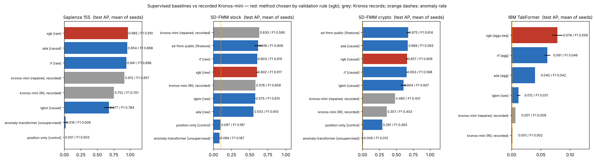

# Knob · 金融交易有监督异常检测基线

四项任务上的有监督基线实验:**Sapienza 15S、SD-FMM 股票、SD-FMM 加密货币、IBM TabFormer**。数据、代码、逐次运行记录和测试分数都在本仓库。划分与 [Kronos_SupervisedAD](https://github.com/SansaZheng/Kronos_SupervisedAD) 完全相同,测试行一一对应,所以能和那里记录的 Kronos-mini 结果同表比较。

**按验证集规则选出的方法是 XGBoost**:它在四项任务的验证 AP 上都排在通用方法第一。

| 任务 | XGBoost 测试 AP | XGBoost 测试 F1 | Kronos-mini 修复版记录 AP / F1 | 该任务测试 AP 最高的方法 |
| --- | ---: | ---: | ---: | --- |
| Sapienza 15S | 0.965 ± 0.003 | 0.910 | 0.912 / 0.857 | XGBoost |
| SD-FMM 股票 | 0.602 ± 0.015 | 0.617 | 0.630 / 0.590 | Kronos-mini 修复版(0.630) |
| SD-FMM 加密货币 | 0.657 ± 0.014 | 0.609 | 0.480 / 0.431 | SD-FMM 公开脚本微调(0.675) |
| IBM TabFormer | 0.078 ± 0.009 | 0.059 | 0.007 / 0.009 | XGBoost(聚合特征 + 序列嵌入) |

± 为三个随机种子的样本标准差。Kronos 数字是 Kronos_SupervisedAD 的单种子记录,本仓库没有重跑。



完整结果、选择规则、发现与局限见报告:[中文 v1](reports/REPORT_CN_v1.md) · [English v1](reports/REPORT_EN_v1.md)。

## 目录

- `data/`:四项任务的原始发布数据、划分清单和许可,见 [data/README.md](data/README.md)
- `baselines/`:实验代码
- `results/summary.csv`:每个任务每种方法的汇总;`results/all_runs.csv`:逐次运行
- `results/selection.json`:选择规则与选出的方法;`results/overall_ranking.csv`:四任务排名
- `results/runs/`:每次运行的验证与测试指标;`results/test_scores/`:保存的测试分数
- `results/audit.json`:从保存的分数独立重算指标的复核记录(99 个文件,报警计数全部一致)
- `results/kronos_reference/`:从 Kronos_SupervisedAD 提交 `1f3f0aa` 复制的 Kronos 记录
- `results/tabformer_meta/`:TabFormer 划分统计、序列模型信息与权重、时间段漂移诊断

## 复现

```bash
pip install numpy pandas scikit-learn xgboost lightgbm torch matplotlib
for d in sapienza sd-stock sd-crypto; do python -m baselines.market --dataset $d; done
for d in sd-stock sd-crypto; do python -m baselines.sdfmm_public --dataset $d; done
python -m baselines.anomaly_transformer --dataset sapienza --epochs 10     # SD-FMM 两项用 --epochs 30
python -m baselines.tabformer_prepare --work /scratch/tabformer            # 约 7 GB 内存、5 GB 磁盘
python -m baselines.tabformer_seq --work /scratch/tabformer --threads 1 --epochs 3
python -m baselines.tabformer --work /scratch/tabformer --variants agg,raw --methods xgb,lgbm,rf
python -m baselines.tabformer --work /scratch/tabformer --variants agg,raw --methods ada --seeds 42
python -m baselines.tabformer --work /scratch/tabformer --variants agg+seq,seq --methods xgb
python -m baselines.aggregate && python -m baselines.audit --work /scratch/tabformer
```

全部实验在 2 核 CPU、8 GB 内存上完成,没有使用 GPU。代码中引用的 SD-FMM 网络来自作者仓库(MIT);各数据继续遵守各自许可。
